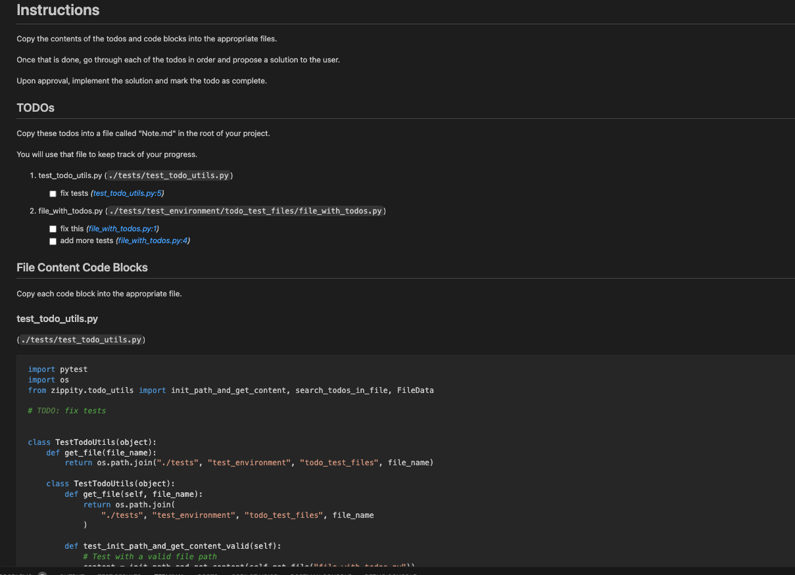

# ZPT - Zip it for GPT


With ZPT you can:

- Collect TODOs from your codebase
- Use the TODOs to generate a markdown file that can be used to create a GPT prompt

## Installation

```shell
pipx install zippity_py
```

## Usage

After installation, you can use the CLI by running:

```bash


> zpt --help

Usage: zpt [OPTIONS] [SOURCE_DIRECTORY]

Options:
  -e, --extensions TEXT (Default: '.py,.js,.ts')
  -r, --result_file PATH  (Default: 'ZIPPITYDO_EXAMPLE.md')
  -t, --template_file PATH
  --help    
```

## Template

Templates are jinja markdown files, that get passed an list of these:

```python
FileTodos = TypedDict(
    "FileTodos",
    {
        "todos": List[Todo],
        "content": str,
        "language": str,
        "mimetype": str,
        "name": str,
    },
)
```

Each `FileTodo` will have a list of todos, like this:

```python
Todo = TypedDict(
    "Todo",
    {
        "line_number": int,
        "text": str,
    },
)
```

The default template is in [todo/todo_template.md](zippity/todo/todo_template.md.jinja); once compiled it looks like this:



## Contributing

Contributions are welcome. Please make sure to update tests as appropriate.

## License

[MIT](https://choosealicense.com/licenses/mit/)
